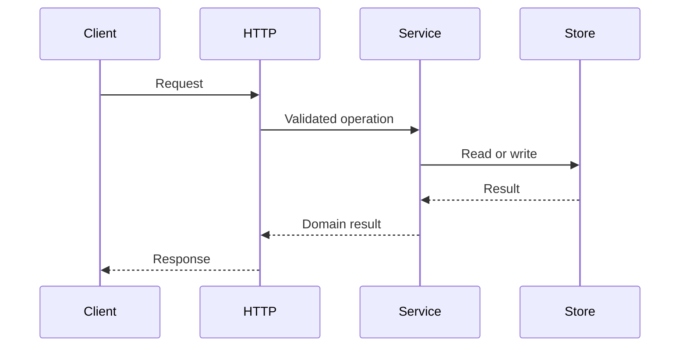

# Presenting a plan for review

Use the same structure in the saved plan and review response. Tables make comparable records
scannable; trees show order and parallel work. Keep prose for explanations and code fences for
sketches. Presentation never replaces required evidence, task checks or explicit dependencies.

## Tables

| Material | Columns |
|---|---|
| Summary | Field, value: change, size, footprint, open decisions, top risk |
| Decision options | Option, approach, consequence; recommendation and evidence below |
| Affected areas | Area, proposed change, evidence |
| Change map | Add/change/remove, file, purpose, estimated size |
| Stories | Id, goal, acceptance summary, needs, planning state |
| Task overview | Qualified id, outcome, files, decisions, needs |
| Task verification | Same id, public test boundary, expected outcomes, command/done-check |
| Context changes | Glossary/contract/rule, proposed change, canonical location |
| Multiple risks | Risk, effect, mitigation/check |

Use short cells and backticks for paths and commands. Split wide tables by purpose, joined by
ids, rather than burying long code, nested lists or full test bodies in cells. Show actual check
commands and the behavior each must prove. One regression command can be shared, but each task
still has its own behavioral check. Documentation tasks use an appropriate review/check.
Use simple Markdown tables, not hand-drawn box borders. Keep Tweak to its short handoff.

## Dependency trees

Show a tree alongside story and task tables whenever those sections exist. Label the direction:
children depend on their parent; siblings can proceed in parallel unless their Needs cells say
otherwise. Group independent roots under a neutral label. Do not draw false dependencies just
to get a tidy tree. For a join, show it once and list all prerequisites in the table and tree.

```text
Stories — children depend on parent
work.1 Accounts
├── work.2 Task API
│   └── work.4 Import [also needs work.3]
└── work.3 Admin client
```

```text
Tasks — children depend on parent
work.1/T1 Register user + tests
└── work.1/T2 Sign in + tests
    └── work.1/T3 Verify identity + tests
        └── work.1/T4 Usage docs
```

A dependency expresses ordering, not completed work. Qualify ids everywhere so references remain
unambiguous. Mark draft story detail as awaiting approval; only approval makes it planned.

## Mermaid where it helps

Use Mermaid when showing request flow, component interactions, branching behavior or a graph
whose joins are harder to read as a tree. Do not add a chart for every section. Keep dependency
edges consistent with the tables. A diagram supplements real signatures and code sketches.



If Mermaid rendering is unavailable, use a fenced text flow or tree with the same information.
Avoid decorative banners, excessive emoji, or diagrams that merely repeat a one-step statement.
